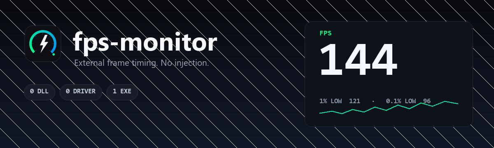

# fps-monitor



一个尽量精简的 Windows FPS 叠加层：

- **FPS**、**1% Low**、**0.1% Low**
- **CPU 占用**、**GPU 占用**、**GPU 温度**
- 置顶、点击穿透、逐像素透明的叠加层
- 设置窗口支持系统里所有已安装字体、位置、颜色、透明度和背景

**除 PresentMon 外没有 DLL、没有 PawnIO、没有内核驱动、没有安装程序、没有网络功能。**
CPU 占用、GPU 占用和 GPU 温度直接来自 Windows API；只有 FPS 需要 PresentMon 读取
ETW 帧事件。

> 这个版本已经移除 CPU 温度。CPU 温度必须加载内核驱动（LibreHardwareMonitor +
> PawnIO 或 Core Temp），和“零 DLL / 零驱动”的目标冲突。如果你需要 CPU 温度，请使用
> 旧版本或 HWiNFO 之类的工具。

## 系统要求

- Windows 10 / 11（x64）
- **管理员权限**：FPS 采集要创建 ETW 会话，这是 Windows 的硬性要求。程序启动时会请求
  UAC；拒绝后设置窗口标题和状态栏会提示，也可以点 **Run as administrator** 重新提权。
- 游戏请使用**无边框窗口 / 窗口化全屏**；叠加层无法画在独占全屏上。

## 下载

| 文件 | 说明 |
| --- | --- |
| `fps-monitor-<版本>-win64.zip` | **推荐**。解压后运行 `fps-monitor.exe`，保留旁边的 `bin\PresentMon.exe`。 |
| `fps-monitor-<版本>-win64-single.exe` | 单文件版。首次运行把 PresentMon 解包到 `%LOCALAPPDATA%\fps-monitor\runtime`。 |

exe 未签名，SmartScreen 可能提示“未知发布者”，点 **更多信息 → 仍要运行**。

## 使用

1. 运行 `fps-monitor.exe`，接受 UAC。
2. 勾选指标、改颜色、选位置，修改立即生效并保存到
   `%APPDATA%\fps-monitor\config.json`。
3. 启动游戏或切换到任意应用，FPS 会挂到当前前台应用上；玩游戏时把设置窗口最小化。
4. **Hide overlay** 临时隐藏叠加层；**Quit** 或关闭设置窗口退出。

## FPS 排查（重要）

### 先确认提权

非管理员时，设置窗口标题会变成
`fps-monitor - run as administrator for FPS`，状态栏也会变红。点 **Run as administrator**，
接受 UAC 后重开。

### 采集当前前台应用

现在不再限制“必须是 3D 游戏”。Chrome、Explorer、桌面、Steam 等任何前台窗口都会成为目标，
FPS 就是该应用的呈现帧率；如果它当前不呈现帧（例如最小化、静态桌面），显示 `--` 是正常的。
`fps-monitor` 自己的设置窗口会被排除，避免把设置窗口的刷新当成目标。

单进程应用（大多数游戏）按**前台 PID**匹配。Chrome、Edge、Firefox、VS Code 这类多进程
应用按**可执行文件名**匹配，因为真正提交帧的是同名的 GPU 子进程。新目标需要在前台稳定约
1.5 秒才切换，避免 Explorer、任务栏、反作弊 helper 的瞬时焦点变化造成反复重启和空档。
设置窗口获得焦点时会保留上一个目标，不会立刻把 FPS 清空；切换应用的瞬间短暂显示 `--`
是正常的。

### 查看日志

每次启动都会覆盖写入 `%APPDATA%\fps-monitor\fps.log`，包含：

- 是否管理员、是否在 **Performance Log Users** 组
- 前台进程 PID / 进程名（游戏是否被识别）
- PresentMon 参数、stderr、退出
- CSV 表头、识别到的帧时间列、第一帧

如果 FPS 一直是 `--`，先看这个文件：

```powershell
notepad %APPDATA%\fps-monitor\fps.log
```
### ETW 错误 1450

本机实测日志中曾出现：

```
PresentMon stderr: error: failed to start trace session: error code 1450.
```

`1450` 是 `ERROR_NO_SYSTEM_RESOURCES`，不是程序 bug。它通常来自 ETW 会话/显卡 Provider
资源不足或权限不完整。按顺序尝试：

1. **重启电脑**。这一步能清掉残留的 ETW 会话（尤其是反作弊和系统日志留下的会话）。
2. 确认运行程序的账户在 **Performance Log Users** 组：
   ```powershell
   net localgroup "Performance Log Users"
   ```
   不在的话，用管理员执行（把 `<用户名>` 换成你的账户）：
   ```powershell
   net localgroup "Performance Log Users" <用户名> /add
   ```
   然后**注销或重启**，组成员身份才会进入新令牌。
3. 关闭游戏反作弊/其他覆盖层（MSI Afterburner、RivaTuner、NVIDIA App 覆盖层等）后，
   用普通 3D 程序测试。部分反作弊（例如永劫无间的 ACE）会加载 `ACE-ADVT` /
   `ACE-CORE*` 内核驱动并注册大量 ETW 会话，阻止 `Microsoft-Windows-DXGI` /
   `DxgKrnl` Provider；这种情况下任何纯外部 FPS 工具都读不到该游戏，只能使用反作弊
   允许的游戏内 FPS，或使用 RTSS 这类注入式工具（注意账号风险）。
4. 仍然 1450 的话，把 `fps.log` 和 `fps-monitor.exe --check` 的输出发出来。

`--check` 现在会打印 `Performance Log Users: yes/no`，可以直接确认第 2 步。

### 1% Low 的样本量

- 1% Low 至少需要 120 帧（60fps 下约 2 秒）
- 0.1% Low 至少需要 1000 帧（约 17 秒）

刚进游戏短暂显示 `--` 正常。

## 配置

`%APPDATA%\fps-monitor\config.json`，原子写入。旧版 `%APPDATA%\GameOverlay\config.json`
会在首次启动时作为回退读取。

```json
{
  "position": "Top Right",
  "margin": 24,
  "font_family": "Consolas",
  "font_size": 14,
  "opacity": 92,
  "show_background": true,
  "bg_color": "#101014",
  "metrics": {
    "fps":       { "enabled": true,  "label": "FPS",      "color": "#00ff88" },
    "fps_low":   { "enabled": true,  "label": "1% LOW",   "color": "#00e0a0" },
    "fps_low01": { "enabled": false, "label": "0.1% LOW", "color": "#7fffd4" },
    "cpu":       { "enabled": true,  "label": "CPU",      "color": "#ffcc00" },
    "gpu":       { "enabled": true,  "label": "GPU",      "color": "#cc66ff" },
    "gpu_temp":  { "enabled": true,  "label": "GPU°",     "color": "#ff6699" }
  }
}
```

颜色用 `#rrggbb`。缺失/非法值回退默认；旧配置里的 `cpu_temp` 字段会被忽略。

## 目录结构

```
fps-monitor/
├─ src/
│  ├─ main.rs            启动、命令行、提权、诊断入口
│  ├─ app/               config / assets / 共享状态
│  ├─ platform/          Win32 工具、字体枚举、提权、SHA-256
│  ├─ sensors/           Windows GPU 温度/占用
│  ├─ ui/                叠加层渲染、原生设置窗口
│  └─ workers/           FPS（PresentMon）、原生 CPU/GPU 轮询
├─ assets/               banner.png、icon.ico
├─ vendor/               PresentMon.exe + SHA256SUMS + 说明
├─ scripts/              vendor 校验 / 更新校验和
├─ build.rs              资源校验、版本号、图标与 VERSIONINFO
└─ .github/workflows/    CI 构建与 Release
```

## 从源码构建

需要 Rust 1.82+。图标/版本资源需要 Windows SDK 的 `rc.exe` 或 MinGW 的 `windres`；
两者都没有时会跳过资源并警告，不影响运行。

```powershell
cargo run --release
```

开发时直接使用 `vendor\` 里的 PresentMon，不需要复制。手动组装发布目录：

```powershell
cargo build --release
New-Item -ItemType Directory -Force dist\fps-monitor\bin | Out-Null
Copy-Item target\release\fps-monitor.exe dist\fps-monitor\
Copy-Item vendor\PresentMon.exe dist\fps-monitor\bin\
```

单文件版：

```powershell
cargo build --release --features embed-assets
```

正式发布由 CI 完成，没有本地打包脚本。

## 依赖

唯一的外部文件是 **Intel PresentMon 2.5.1**（MIT），由
[`vendor/SHA256SUMS`](vendor/SHA256SUMS) 固定：

- 编译前 [build.rs](build.rs) 校验，不匹配直接失败；
- CI 再用 [`scripts/verify-vendor.ps1`](scripts/verify-vendor.ps1) 独立校验；
- 文件夹版放在 `bin\`；单文件版嵌入 exe，首次运行解包到
  `%LOCALAPPDATA%\fps-monitor\runtime\<内容ID>\`，逐个 SHA-256 校验，损坏自动重解包；
- 主程序调用 `SetDefaultDllDirectories(LOAD_LIBRARY_SEARCH_DEFAULT_DIRS)`，把当前工作目录
  从 DLL 搜索路径移除。

**没有 LibreHardwareMonitor、没有 .NET DLL、没有 PawnIO。** GPU 温度来自
`D3DKMTQueryAdapterInfo(ADAPTER_PERFDATA)`，GPU 占用来自 `GPU Engine` PDH 计数器，CPU
占用来自 `GetSystemTimes`。详见 [vendor/README.md](vendor/README.md)。

## 诊断

| 命令 | 输出 |
| --- | --- |
| `fps-monitor.exe --check` | 校验 PresentMon、管理员、Performance Log Users、GPU → `%APPDATA%\fps-monitor\check.txt` |
| `fps-monitor.exe --selftest [--seconds N]` | 实际采样 → `selftest.txt` |
| `fps-monitor.exe --ui-smoke [--seconds N]` | 创建窗口并验证叠加层宽度稳定 → `ui-smoke.txt` |
| `fps-monitor.exe --version` / `--help` | 终端输出 |

启动失败先写 `%APPDATA%\fps-monitor\error.txt` 再弹窗。叠加层数值采用“标签列 + 预留数值列
+ 右对齐”，`9 %` 变 `100 %` 不会改变宽度；`ui-smoke.txt` 中的
`width before/after value change` 可用于回归。

## GitHub Actions 与发布

[.github/workflows/build.yml](.github/workflows/build.yml) 在 push、PR、手动触发和 `v*`
tag 时运行：

1. 校验 `vendor/SHA256SUMS`；
2. `cargo fmt --check`、两种 feature 的 `clippy -D warnings`、`cargo test`；
3. 构建 `fps-monitor.exe` + `bin\PresentMon.exe` 的 zip，以及单文件版；
4. 两个产物分别 `--check`（单文件版先清缓存）和一次 `--ui-smoke`；
5. 上传产物；tag 构建自动创建 GitHub Release。

发布只需：

```powershell
git tag v2.1.0
git push origin v2.1.0
```

版本号写入 exe 的 VERSIONINFO、产物文件名和 Release 说明；分支构建为 `0.0.0-dev`。

## 许可证

MIT。PresentMon 也是 MIT，见 [vendor/README.md](vendor/README.md)。
